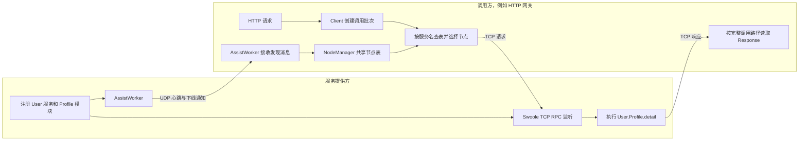

# EasySwoole RPC 6.x

基于 Swoole 协程与 TCP 短连接的 RPC 组件。服务端通过 `Service.Module.action` 分发请求，客户端通过节点管理器发现服务节点，并发完成多个调用。

## 设计与调用流程

RPC 让一个进程调用另一个进程里的 PHP 方法。以 `User.Profile.detail` 为例，`User` 是服务名，`Profile` 是服务下的模块，`detail` 是对外开放的 Action。运行该服务的实例称为节点，每个节点通告自己的 TCP 地址和端口。



UDP 负责告诉客户端去哪里调用。TCP 负责传输参数和结果。默认节点表由调用方的辅助进程和 worker 共享，默认选节点策略按权重随机选择。同一个 `Rpc` 实例可以复用，每次调用通过 `buildRequest()` 创建独立批次。

## 环境要求

- PHP >= 8.1
- Swoole >= 5.1

```bash
composer require easyswoole/rpc:^6.0
```

## 快速开始：从服务注册到 HTTP 调用

在安装了依赖的目录中依次创建 `service.php`、`server.php` 和 `gateway.php`。示例在本机运行两个独立进程。

### 1. 定义 Service、Module 和 Action

将下面的代码保存为 `service.php`。

```php
<?php

namespace App\Rpc;

use EasySwoole\Rpc\AbstractInterface\AbstractService;
use EasySwoole\Rpc\AbstractInterface\AbstractServiceModule;
use EasySwoole\Rpc\Attribute\RpcAction;
use EasySwoole\Rpc\Protocol\Request;

final class UserService extends AbstractService
{
    public function serviceName(): string
    {
        return 'User';
    }
}

final class ProfileModule extends AbstractServiceModule
{
    public function moduleName(): string
    {
        return 'Profile';
    }

    #[RpcAction]
    public function detail(mixed $arg, Request $request): array
    {
        return [
            'id' => (int) $arg['id'],
            'name' => 'EasySwoole',
            'requestUUID' => $request->getRequestUUID(),
        ];
    }
}
```

完整调用路径由三段组成：

```text
User.Profile.detail
  │      │      └─ 标记了 #[RpcAction] 的 public 方法
  │      └──────── Module::moduleName()
  └─────────────── Service::serviceName()
```

### 2. 注册服务并配置 UDP 通告

将下面的代码保存为 `server.php`。服务端监听 TCP 9601，并向网关的 UDP 9600 发送心跳。

```php
<?php

use App\Rpc\ProfileModule;
use App\Rpc\UserService;
use EasySwoole\Rpc\Rpc;
use EasySwoole\Rpc\Config\RpcConfig;
use EasySwoole\Rpc\Config\DiscoveryConfig;
use EasySwoole\Rpc\Config\ServerConfig;
use EasySwoole\Rpc\Config\SecurityConfig;
use Swoole\Server;

require __DIR__ . '/vendor/autoload.php';
require __DIR__ . '/service.php';

$rpc = new Rpc(config: new RpcConfig(
    server: new ServerConfig(
        advertiseHost: '127.0.0.1', // 客户端能够访问的主机名或 IP，不能写 0.0.0.0
        listenAddress: '127.0.0.1', // RPC listener 实际绑定地址
        listenPort: 9601,         // RPC 对外监听端口
        nodeId: 'user-rpc-node-1', // 可选：跨重启保持稳定的节点唯一标识
        nodeName: 'user-rpc-1',
    ),
    discovery: new DiscoveryConfig(
        broadcast: true,
        broadcastAddresses: ['127.0.0.1:9600'],
        broadcastIntervalMs: 1000,
    ),
    security: new SecurityConfig(apiKey: 'local-demo-key'),
));

$service = new UserService();
$service->addModule(new ProfileModule());
$rpc->server()->registerService($service);

$rpc->server()->setOnException(static function (Throwable $throwable): void {
    // 捕获请求处理阶段未预料到的服务端异常。
    error_log('[rpc exception] ' . $throwable->getMessage());
});

$rpc->server()->setOnRuntimeError(static function (string $message): void {
    // 捕获服务端心跳、节点登记、UDP 等后台运行错误。
    error_log('[rpc server runtime] ' . $message);
});

// 9501 是宿主 Server 的主端口；独立 RPC 进程监听 9601。
$server = new Server('127.0.0.1', 9501, SWOOLE_PROCESS, SWOOLE_SOCK_TCP);

// 主端口使用 TCP Server 时必须有自己的 receive 回调；它不负责 RPC 请求。
$server->on('receive', static function (Server $server, int $fd): void {
    $server->close($fd);
});

// attachServer 必须在 start 前调用，而且同一个 Rpc Server 只能调用一次。
$rpc->server()->attachServer($server);
$server->start();
```

运行：

```bash
php server.php
```

### 3. 启动 HTTP 网关，自动发现并调用服务

下面的网关在启动前创建一个共享的 `Rpc` 实例，并把 UDP 发现辅助进程挂载到 HTTP Server。辅助进程收到心跳后，将节点写入与 HTTP worker 共享的节点表。每个 HTTP 请求使用同一个 RPC 客户端创建独立批次。

将以下代码保存为 `gateway.php`。它调用快速开始中的 `User.Profile.detail`。

```php
<?php

use EasySwoole\Rpc\Config\DiscoveryConfig;
use EasySwoole\Rpc\Config\RpcConfig;
use EasySwoole\Rpc\Config\SecurityConfig;
use EasySwoole\Rpc\Config\ServerConfig;
use EasySwoole\Rpc\Rpc;
use Swoole\Http\Request;
use Swoole\Http\Response;
use Swoole\Http\Server;

require __DIR__ . '/vendor/autoload.php';

$rpc = new Rpc(new RpcConfig(
    server: new ServerConfig(listenAddress: '127.0.0.1', listenPort: 9502),
    discovery: new DiscoveryConfig(listen: true, listenAddress: '127.0.0.1', listenPort: 9600),
    security: new SecurityConfig(apiKey: 'local-demo-key'),
));
$client = $rpc->client();
$server = new Server('127.0.0.1', 8080, SWOOLE_PROCESS);
$server->set(['worker_num' => 2, 'enable_coroutine' => true]);
$server->on('request', static function (Request $request, Response $http) use ($client): void {
    $batch = $client->buildRequest();
    $batch->addCall('User.Profile.detail')->setArg(['id' => 1001]);
    $response = $batch->exec(timeout: 1.0)['User.Profile.detail'];

    $http->status($response->isSuccess() ? 200 : 502);
    $http->header('Content-Type', 'application/json');
    $http->end($response->toJson());
});

$rpc->server()->attachServer($server);
$server->start();
```

在另一个终端运行 `php gateway.php`，再访问：

```bash
curl http://127.0.0.1:8080/
```

发现节点后，HTTP 返回 200，响应的 `status` 为 0，`result` 包含用户 ID、姓名和请求 UUID。第一条心跳到达前返回 HTTP 502，RPC 状态为 `NOT_AVAILABLE_NODE`。

本机运行时使用上面的回环地址。跨机器运行时，把网关 UDP 监听地址改为可接收心跳的地址，并将发送目标改为网关的可达 IP 和 UDP 端口。服务节点仍通过心跳通告自己的 TCP RPC 地址。

### 可选：命令行直接调用固定节点

将示例保存为 `client.php`。这个客户端在协程里直接调用上面的服务端。

```php
<?php

use EasySwoole\Rpc\Rpc;
use EasySwoole\Rpc\Config\RpcDependencies;
use EasySwoole\Rpc\Config\RpcConfig;
use EasySwoole\Rpc\Config\SecurityConfig;
use EasySwoole\Rpc\Server\ServiceNode;
use EasySwoole\Rpc\Utility\SwooleTableNodeManager;

require __DIR__ . '/vendor/autoload.php';

$nodeManager = new SwooleTableNodeManager();
$nodeManager->online(new ServiceNode(
    serviceName: 'User',
    nodeId: 'user-rpc-1', // 同一 Service 下必须稳定且唯一
    nodeName: 'user-rpc-1',
    nodeWeight: 10,
    host: '127.0.0.1',
    port: 9601,
));

$rpc = new Rpc(
    config: new RpcConfig(security: new SecurityConfig(apiKey: 'local-demo-key')),
    dependencies: new RpcDependencies(nodeManager: $nodeManager),
);

\Swoole\Coroutine\run(static function () use ($rpc): void {
    $batch = $rpc->client()->buildRequest();
    $batch->addCall('User.Profile.detail')
        ->setArg(['id' => 1001])
        ->setClientArg(['traceId' => 'trace-001']);

    $response = $batch->exec(timeout: 3.0)['User.Profile.detail'];

    if (!$response->isSuccess()) {
        throw new RuntimeException(sprintf(
            'RPC failed: status=%d, message=%s',
            $response->getStatus()->value,
            (string) $response->getMsg(),
        ));
    }

    var_dump($response->getResult());
});
```

运行：

```bash
php client.php
```

预期结果：

```text
array(3) {
  ["id"]=> int(1001)
  ["name"]=> string(10) "EasySwoole"
  ["requestUUID"]=> string(32) "..."
}
```

固定节点只适合本地验证或外部配置已经保证节点稳定的场景。生产环境通常应使用 Redis、Etcd 等集中式 NodeManager，或者在可信内网中启用 UDP 服务发现。

## 1. 定义服务

Service 只声明服务名称、权重并管理 Module，不直接暴露 Action。

```php
<?php

namespace App\Rpc;

use EasySwoole\Rpc\AbstractInterface\AbstractService;

final class UserService extends AbstractService
{
    // serviceName 会进入调用路径，并作为节点分组键使用。
    public function serviceName(): string
    {
        return 'User';
    }

    // 默认值为 10。权重越大，被选中的概率越高。
    public function serviceWeight(): int
    {
        return 20;
    }

}
```

Service 找不到请求指定的 Module 时，会调用可覆写的 `moduleNotFound()`，不会在 Service 层判断 Action。

## 2. 定义 Module

所有远程 Action 都定义在 Module 中。只有标记了 `#[RpcAction]` 的 public 方法才能被调用；Action 是否存在及是否允许调用完全由 `AbstractServiceModule` 处理。

```php
<?php

namespace App\Rpc;

use EasySwoole\Rpc\AbstractInterface\AbstractServiceModule;
use EasySwoole\Rpc\Attribute\RpcAction;
use EasySwoole\Rpc\Protocol\Request;

final class ProfileModule extends AbstractServiceModule
{
    // 完整调用路径的第二段：User.Profile.getUser。
    public function moduleName(): string
    {
        return 'Profile';
    }

    // 只有带 RpcAction 的 public 方法才能被远程调用。
    #[RpcAction]
    public function getUser(mixed $arg, Request $request): array
    {
        return [
            'id' => (int) $arg['id'],
            'name' => 'EasySwoole',
            'requestId' => $request->getRequestUUID(),
        ];
    }

    #[RpcAction]
    public function detail(mixed $arg): array
    {
        return ['userId' => (int) $arg['id'], 'bio' => 'Hello RPC'];
    }

    // 没有 RpcAction，不可被远程调用。
    public function internalHelper(): string { return 'internal'; }
}
```

调用路径为 `User.Profile.getUser`。Module 找不到 Action 时会调用可覆写的 `actionNotFound()`。

注册 Module：

```php
$userService = new UserService();
// 必须先完成所有 Module 装配，再注册 Service。
$userService->addModule(new ProfileModule());
// 注册后 Service 会被冻结，不能再增加 Module。
$rpc->server()->registerService($userService);
```

Service 注册后由 `ServiceRegistry` 统一冻结，不能继续添加 Module；重复的 `moduleName()` 也会在注册阶段抛出异常。所有 Module 必须在 `registerService()` 前完成装配。

`addModule()` 会在装配阶段一次性反射并缓存带有 `#[RpcAction]` 的方法；请求处理阶段不会重复执行反射。Action 必须是 public、非 static，不能使用 `__` 开头的保留名称，必填参数不能超过框架传入的 `$arg`、`Request`、`ResponseBuilder` 三个参数，也不能声明返回 `Response` 或 `ResponseBuilder`。不合法的定义会在 Module 注册时立即抛出 `RpcException`，避免运行到真实请求时才暴露配置错误。Module 可以自由定义自己的构造函数，不需要调用框架父构造函数。

每次请求由 `ServerRequestHandler` 创建独立的 `ResponseBuilder`。Service 和 Module 的 `__dispatch()` 使用它构建响应，分发及钩子结束后由处理器生成只读的 `Response`。Service 和 Module 实例会被多个协程复用，请把请求和构建器保留在当前调用的局部变量中。

Action 通过返回值提供业务结果，框架会将该值写入构建器。Action 使用第三个参数 `ResponseBuilder` 设置状态、消息和节点健康标记。`setResult()` 供框架分发器和服务端钩子使用，Action 正常返回时以其返回值为准。覆写 `afterRequest()`、`moduleNotFound()`、`actionNotFound()` 或 Service/Module 的 `onException()` 时，原响应参数的类型也改为 `ResponseBuilder`。

推荐让 Action 只返回能够被 JSON 编码的业务数据：

```php
#[RpcAction]
public function detail(mixed $arg): array
{
    return ['id' => (int) $arg['id']];
}
```

需要调整响应元数据时，使用框架注入的 `ResponseBuilder`：

```php
use EasySwoole\Rpc\Protocol\Request;
use EasySwoole\Rpc\Protocol\ResponseBuilder;

#[RpcAction]
public function detail(mixed $arg, Request $request, ResponseBuilder $response): array
{
    // requestUUID 由框架维护。
    $response->setMsg('读取成功');

    return ['id' => (int) $arg['id']];
}
```

不要返回资源、闭包、递归对象等不能被 JSON 编码的值。服务端会通过全局 `onException` 上报序列化失败。配置了该回调时，客户端收到隐藏内部细节的 `SERVICE_ERROR`，节点健康标记为 `HEALTHY`。

## 3. 启动 RPC 服务端

### 挂载到 Swoole Server

```php
<?php

use App\Rpc\ProfileModule;
use App\Rpc\UserService;
use EasySwoole\Rpc\Rpc;
use EasySwoole\Rpc\Config\RpcConfig;
use EasySwoole\Rpc\Config\DiscoveryConfig;
use EasySwoole\Rpc\Config\ServerConfig;
use Swoole\Server;

require __DIR__ . '/vendor/autoload.php';

$rpc = new Rpc(
    config: new RpcConfig(
        server: new ServerConfig(
            advertiseHost: '127.0.0.1', // 客户端实际连接的主机名或 IP，不能填写 0.0.0.0
            listenAddress: '0.0.0.0', // RPC TCP listener 的绑定地址
            listenPort: 9601,         // RPC TCP 进程绑定此端口
            nodeName: 'user-rpc-1',   // 便于日志和运维识别
        ),
        discovery: new DiscoveryConfig(
            // 使用固定节点或集中式注册中心时，可以关闭 UDP 发现。
            listen: false,
            broadcast: false,
        ),
    ),
);

$service = new UserService();
$service->addModule(new ProfileModule());
// 必须在 attachServer() 前注册；attach 开始后 Registry 将被冻结。
$rpc->server()->registerService($service);

$rpc->server()->setOnException(
    function (Throwable $throwable): void {
        // 记录没有被 Service 或 Module 明确处理掉的异常。
        error_log($throwable->getMessage());
    },
);

$server = new Server('0.0.0.0', 9501, SWOOLE_PROCESS, SWOOLE_SOCK_TCP);
// 主端口是普通 TCP 监听，需要由应用注册自己的回调；RPC 进程独立监听 9601。
$server->on('receive', static function (Server $server, int $fd): void {
    $server->close($fd);
});
// 传主 Server 即可，RPC listener 与 AssistWorker 会自动挂载。
$rpc->server()->attachServer($server);
$server->start();
```

Service 和 Module 的默认 `onException()` 会原样重新抛出异常：Module 未处理的异常先冒泡到 Service，Service 仍未处理时继续进入 Server 全局 `onException`，避免开发阶段静默丢失错误。Server 没有配置全局 `onException` 时，异常会直接交还调用层，不会被框架转换或吞掉；开发和部署时必须显式配置该回调。配置后，回调负责记录和告警，客户端只会收到 `ResponseStatus::SERVICE_ERROR` 和统一的 `Server error.`，不会暴露异常消息、文件和行号。线上业务如果能够明确处理异常，也可以覆写 Service 或 Module 的 `onException()`，通过 ResponseBuilder 设置响应并写入自己的日志；覆写方法正常返回即表示异常已经处理，不再通知上层。TCP 固定包头校验失败时直接关闭连接。包头通过后，包体未在截止时间内收齐时关闭连接。包体哈希、JSON 解析、请求结构或内层签名错误均返回 `ILLEGAL_PACKAGE`，消息标明原因。内层验签失败时回显原请求 UUID，无法安全提取 UUID 时响应中的 UUID 为空。

有本机服务时，`attachServer()` 通过宿主的 `addProcess()` 挂载独立 TCP 进程和一个 `AssistWorker`。TCP 进程默认三个，通过 `SO_REUSEPORT` 共用一个地址和端口，需要部署系统支持该选项。宿主负责进程启停，TCP 进程自行接收连接和执行 Action。有本机服务且宿主已占用 RPC 端口时，挂载会抛出异常。只调用远端服务的网关只启动 `AssistWorker`。

TCP 短连接在请求结束后关闭。客户端提前断开时，回包失败不会触发运行错误回调。

挂载成功表示进程已交给宿主管理。TCP 进程在宿主启动后绑定端口。每个 RPC Server 只允许尝试挂载一次。

| ServerAttachStatus | 含义 |
| --- | --- |
| `PENDING` | 尚未执行 `attachServer()`，允许注册 Service |
| `ATTACHING` | 正在执行预检和资源提交，不允许再修改 Service |
| `ATTACHED` | RPC 自定义进程已挂载到宿主 |
| `FAILED` | 挂载失败；当前 RPC Server 实例不可重试，应重建 Swoole Server 和 RPC 实例 |

### 挂载到已有 HTTP Server

已有 HTTP Server 时，可以直接用它托管 RPC 进程：

```php
use Swoole\Http\Server;

$server = new Server('0.0.0.0', 9501);
// RPC 进程自行绑定 ServerConfig::listenPort。
$rpc->server()->attachServer($server);
$server->start();
```

本机服务节点的上线、心跳和下线由 `AssistWorker` 维护。

## 4. 客户端调用

客户端必须先能从 NodeManager 中取得服务节点。最简单的固定节点示例如下：

`ServiceNode::nodeId` 是节点身份的一部分，不能为空；同一服务下的每个节点必须使用稳定且唯一的 ID。

```php
<?php

use EasySwoole\Rpc\Protocol\Response;
use EasySwoole\Rpc\Rpc;
use EasySwoole\Rpc\Config\RpcDependencies;
use EasySwoole\Rpc\Server\ServiceNode;
use EasySwoole\Rpc\Utility\SwooleTableNodeManager;

require __DIR__ . '/vendor/autoload.php';

$nodeManager = new SwooleTableNodeManager();
// 固定节点仅用于演示；生产环境通常由 AssistWorker 或注册中心维护。
$nodeManager->online(new ServiceNode(
    serviceName: 'User',
    nodeId: 'user-rpc-1',
    nodeName: 'user-rpc-1',
    nodeWeight: 20,
    host: '127.0.0.1',
    port: 9601,
));

$rpc = new Rpc(dependencies: new RpcDependencies(nodeManager: $nodeManager));
$client = $rpc->client();

$request = $client->buildRequest();
$context = $request->addCall('User.Profile.getUser');
$context
    ->setArg(['id' => 1001])                   // 传给 Action 的业务参数
    ->setClientArg(['traceId' => 'trace-001']) // 链路信息等客户端附加参数
    ->enableRetry(1)                           // 失败后最多再选节点重试一次
    ->setOnSuccess(function (Response $response): void {
        var_dump($response->getResult());
    })
    ->setOnFail(function (Response $response): void {
        var_dump($response->getStatus(), $response->getMsg());
    });

$responses = $request->exec(timeout: 3.0); // timeout 必须大于 0；同一批次中的调用会并发执行
$response = $responses['User.Profile.getUser'];
```

`enableRetry()` 默认不开启。开启后，如果服务端已经执行 Action，但客户端在收到响应前超时或断连，重试可能再次执行同一个 Action。只为幂等 Action 开启重试。

Module 调用使用三段路径：

```php
$client = $rpc->client();
$request = $client->buildRequest();
$request->addCall('User.Profile.detail')->setArg(['id' => 1001]);
$response = $request->exec()['User.Profile.detail'];
```

客户端 `onSuccess`、`onFail` 和 `exec()` 都提供只读的 `Response`，通过 getter 读取状态、结果、消息、节点健康标记和请求 UUID。只读约束作用于响应字段，`result` 或 `msg` 中的对象仍遵循 PHP 的对象引用语义。

### 并发调用多个服务

同一个 RequestBatch 中加入的调用会通过 Swoole 协程并发执行，`exec()` 返回以完整调用路径为键的 `array<string, Response>`，按添加顺序排列。同一个服务的不同 Action 可以在同一批次中调用，重复添加相同路径会立即抛出 `RpcException`。

```php
$client = $rpc->client();
$request = $client->buildRequest();
$request->addCall('User.Profile.getUser')->setArg(['id' => 1001]);
$request->addCall('User.Profile.detail')->setArg(['id' => 1001]);

$responses = $request->exec(timeout: 3.0);
$userResponse = $responses['User.Profile.getUser'];
$profileResponse = $responses['User.Profile.detail'];
```

`Client` 本身不再保存请求队列。每次 `buildRequest()` 都会创建一个独立的 `RequestBatch`，所以同一个 Client 可以在多个协程中并发构建和执行不同批次。RequestBatch 是一次性对象：不能并发执行，执行完成后也不能再次 `exec()` 或继续 `addCall()`；需要发起后续调用时应创建新的 Batch。

`exec()` 必须在 Swoole 协程环境中调用，否则会立即抛出明确的 `RpcException`。`timeout` 是单个 Action 的总 deadline，连接、发送、接收和重试共同消耗这段时间，各阶段只使用剩余时间，不会按阶段重复累计。Batch 开始时会取走当前调用队列，即使回调或扩展组件抛出异常也不会重复执行旧调用。每个调用协程的意外异常（包括 Action 的 `onSuccess` / `onFail` 回调异常）都会独立通知 Client `onException`；配置该回调表示由调用方接管异常，未配置时异常会直接从调用协程抛出。`onException` 回调自身抛出的异常也不会被框架吞掉。如果某项在取得 Response 前抛出异常且由 `onException` 接管，结果会缺少该项的路径键。例如上面的 `User.Profile.getUser` 抛出异常、`User.Profile.detail` 成功时，结果只包含 `User.Profile.detail`。已经取得的 Response 不会因为 Action 回调异常而从 Batch 返回结果中丢失。调用路径会在 `addCall()` 时立即校验。

需要显式指定节点时可以调用 `RequestContext::setServiceNode()`，但节点的 `serviceName` 必须与调用路径第一段完全一致。例如 `User.Profile.detail` 只能指定属于 `User` 服务的节点；不匹配会立即抛出 `RpcException`，不会把请求发送到错误服务。

### 节点故障策略

客户端不会因为一次业务异常就把节点全局下线。默认的 `ConsecutiveFailurePolicy` 行为如下：

- `ResponseStatus::SERVICE_ERROR`：视为业务执行异常，保留节点；
- 连接失败、服务响应超时或读包超时：记录连续失败，默认累计 3 次后下线；
- `ResponseStatus::SERVICE_SHUTDOWN`：服务明确关闭，立即下线；
- 低于下线阈值时，如果启用了重试，会重新选择节点，但不会修改全局节点表；
- 节点成功响应后，连续网络失败计数会被清零。

可以调整连续失败阈值，或注入自己的策略：

```php
use EasySwoole\Rpc\Utility\ConsecutiveFailurePolicy;
use EasySwoole\Rpc\Config\RpcDependencies;

$rpc = new Rpc(
    dependencies: new RpcDependencies(
        // 连续 5 次可疑故障后下线；HEALTHY 响应会清空已有计数。
        failurePolicy: new ConsecutiveFailurePolicy(threshold: 5),
    ),
);
```

只有 Server 提供 `onRuntimeError`。它负责 assist-worker 中无法同步抛回调用方的节点上线、心跳、下线以及 UDP 监听和广播错误，必须在 `attachServer()` 前设置。客户端始终存在明确的调用协程，因此节点管理器、节点选择器、失败策略和未预期传输异常统一进入 Client `onException`，不再提供 `onRuntimeError`。

```php
$rpc->server()->setOnRuntimeError(
    function (string $message): void {
        // Closure 会随 Swoole fork 进入 assist-worker；其中使用的资源需由调用方保证支持 fork。
        logger()->error('[server] ' . $message);
    }
);
```

消息会直接说明节点上线、心跳、下线或 UDP 监听、广播中的具体失败位置。NodeManager 返回 `false` 只表示本次操作失败：流程不会抛异常或停止，后续心跳仍会继续尝试。自定义 NodeManager 遇到注册中心暂时断网等运行失败时也应返回 `false`，不应抛异常。配置错误、端口冲突和 `attachServer()` 失败仍直接抛出 `RpcException`。

自定义策略需要实现 `NodeFailurePolicyInterface`，并返回 `KEEP`、`RETRY_ANOTHER` 或 `OFFLINE`。

## 配置速查

`RpcConfig` 保存运行配置，`RpcDependencies` 提供可替换的 NodeManager、NodeSelector 和 NodeFailurePolicy。省略这两个参数时，框架会创建默认实例。


### RpcConfig

| 配置 | 默认值 | 用途 |
| --- | --- | --- |
| `server` | `new ServerConfig()` | TCP 服务地址、节点名称及本机心跳周期 |
| `discovery` | `new DiscoveryConfig()` | UDP 无主服务发现；默认完全关闭 |
| `security` | `new SecurityConfig()` | RPC 与 UDP 共用的签名密钥和时间戳窗口 |
| `protocol` | `new ProtocolConfig()` | TCP 协议包最大长度 |

### ServerConfig

| 配置 | 默认值 | 注意事项 |
| --- | --- | --- |
| `advertiseHost` | `127.0.0.1` | 注册给客户端连接的主机名或 IP；不能使用 `0.0.0.0` |
| `listenAddress` | `0.0.0.0` | RPC TCP 进程的本地绑定地址 |
| `listenPort` | `9502` | RPC TCP 监听端口；若宿主 Server 已监听该端口会拒绝挂载 |
| `advertisePort` | `null` | 客户端连接端口；为空时使用 `listenPort`，有端口映射时单独设置 |
| `nodeId` | `null` | 可选的稳定节点唯一标识；为空时每次创建 Server 自动生成 UUID，显式配置时不能为空字符串 |
| `nodeName` | 空字符串 | 便于日志和进程识别，不作为节点唯一身份 |
| `heartbeatIntervalMs` | `5000` | AssistWorker 刷新本机节点的周期 |
| `tcpProcessCount` | `3` | 共用一个 RPC TCP 监听端口的进程数 |

### DiscoveryConfig

| 配置 | 默认值 | 注意事项 |
| --- | --- | --- |
| `listen` | `false` | 是否接收其他实例的 UDP 节点广播 |
| `listenAddress` | `0.0.0.0` | UDP 本地绑定地址 |
| `listenPort` | `9600` | UDP 监听端口；attach 前会预检是否可用 |
| `broadcast` | `false` | 是否定时广播本机节点 |
| `broadcastAddresses` | `255.255.255.255:9600` | 目标地址列表，格式为 `host:port` |
| `broadcastIntervalMs` | `5000` | 节点广播周期 |
| `socketRetryIntervalMs` | `5000` | UDP Socket 创建或 bind 失败后的重试周期 |

### SecurityConfig 与 ProtocolConfig

| 配置 | 默认值 | 注意事项 |
| --- | --- | --- |
| `apiKey` | `null` | 为空时不签名；启用后所有通信方必须一致 |
| `timestampToleranceSeconds` | `30` | 签名时间戳允许的前后偏差，要求机器时钟同步 |
| `maxPackageSize` | `2097152` | 2 MiB；客户端和服务端使用同一个限制 |

### RpcDependencies

| 依赖 | 默认实现 | 可替换用途 |
| --- | --- | --- |
| `nodeManager` | `SwooleTableNodeManager` | Redis、Etcd、Consul 等注册中心 |
| `nodeSelector` | `WeightedRandomNodeSelector` | 轮询、一致性哈希、机房优先等负载策略 |
| `failurePolicy` | `ConsecutiveFailurePolicy` | 自定义节点重试及下线判定 |

## 5. 节点心跳与 UDP 服务发现

每个 RPC 实例挂载一个 `AssistWorker`。它通过 fork 前创建的共享表检查 TCP 进程，每个进程成功监听后按 index 刷新心跳。至少一个进程存活时才登记和续约本机节点，全部退出或心跳过期时摘除并发送下线通告。进程恢复监听后重新上线。正常关停时，`AssistWorker` 也会主动发下线通知。

`AssistWorker` 有两组职责：

- 本机节点生命周期始终启用，负责上线、定时心跳和关闭下线；
- UDP 服务发现仅在开启 `listen` 或 `broadcast` 时启用，负责广播、接收远端节点和广播下线。

本机节点心跳周期属于 `ServerConfig`：

```php
$serverConfig = new ServerConfig(
    // AssistWorker 刷新本机全部 Service 节点的周期。
    heartbeatIntervalMs: 5000,
);
```

只有采用无主化注册中心时，才需要开启 UDP 的 `listen` 或 `broadcast`；使用 Redis、Etcd 等集中式 NodeManager 时可以同时关闭它们：

UDP 服务发现默认关闭。默认创建 `Rpc` 时不会绑定 UDP 端口、发送节点广播或接受远端广播；启用无主服务发现时必须显式配置 `listen` 或 `broadcast`。组件不强制 UDP 配置 `apiKey`，调用方可以在可信网络中自行决定是否启用签名；但未配置 `apiKey` 时，UDP 节点上线、心跳和下线数据不会验证来源，能够访问该 UDP 端口的程序都可能伪造服务节点。生产环境是否允许无签名发现及其网络隔离由调用方负责。

```php
$discoveryConfig = new DiscoveryConfig(
    // 关闭后不会创建 UDP Socket 或 UDP 广播定时器。
    listen: false,
    broadcast: false,
);
```

在构造 `Rpc` 时传入 UDP 服务发现配置；`attachServer()` 会自动完成端口预检和 assist-worker 挂载：

```php
use EasySwoole\Rpc\Config\DiscoveryConfig;
use EasySwoole\Rpc\Config\RpcConfig;
use EasySwoole\Rpc\Config\SecurityConfig;

$rpc = new Rpc(
    config: new RpcConfig(
        server: $serverConfig,
        discovery: new DiscoveryConfig(
            listen: true,             // 接收其他实例广播的节点信息
            listenAddress: '0.0.0.0', // UDP 绑定地址
            listenPort: 9701,         // attach 时先检测端口是否可用
            broadcast: true,          // 定时广播本机 Service 节点
            broadcastAddresses: [
                // 填写其他 RPC 实例实际监听的 UDP 地址。
                '127.0.0.1:9702',
                '192.168.1.20:9701',
            ],
            broadcastIntervalMs: 5000,
        ),
        security: new SecurityConfig(
            apiKey: 'replace-with-a-shared-api-key', // 通信双方必须一致
            timestampToleranceSeconds: 30,           // 拒绝超出窗口的重放包
        ),
    ),
);

$rpc->server()->attachServer($server);
$server->start();
```

当 `listen=true` 时，`attachServer()` 会先在主进程中尝试 bind UDP 地址。若端口已被其他程序占用、地址不可用或当前用户没有监听权限，会立即抛出异常，避免 assist-worker 启动后反复退出。预检成功后会立即释放探测 Socket，再由 `AssistWorker` 正式监听。

节点过期判断属于 NodeManager 的职责。内置 `SwooleTableNodeManager` 默认只返回最近 15 秒内收到过心跳的节点，并在查询时移除过期记录；可通过 `nodeTtlSeconds` 调整：

```php
$nodeManager = new SwooleTableNodeManager(nodeTtlSeconds: 30);
```

NodeManager 如果存在确定的 TTL，应覆写 `nodeTtlSeconds(): ?int` 返回秒数。`attachServer()` 会要求 TTL 严格大于本机 `heartbeatIntervalMs`，开启 UDP 广播时还必须严格大于 `broadcastIntervalMs`，避免正常节点在下一次刷新前就过期。无法提供固定 TTL 的外部注册中心可以返回 `null`，由其实现自行保证约束。生产环境建议让 TTL 至少达到刷新周期的 2～3 倍，为调度延迟和短暂网络抖动保留余量。

默认 Table 的 `service` 字段为 64 字节，完整节点 JSON 字段为 4096 字节，对应公开常量 `SERVICE_COLUMN_BYTES` 和 `NODE_COLUMN_BYTES`。写入内容超过字段容量或 JSON 编码失败时，`online()`、`heartbeat()` 返回 `false`，不会写入可能被截断的数据。`false` 是 NodeManager 明确约定的失败结果，不会转换成异常；服务端后台任务可以通过 `onRuntimeError` 记录并继续后续周期。读取时发现损坏记录会将其删除并跳过，不会阻断同一服务下其他健康节点。如果传入自行创建的 `Swoole\Table`，必须使用相同的字段名称、类型和容量。

`ServiceNode` 只保存客户端发现和连接所需的服务名、节点身份、节点名称、权重、对外地址与端口。`listenAddress` 只属于 `ServerConfig` 的本地监听配置，不会写入 ServiceNode、注册中心或 UDP 广播数据。

自定义 NodeManager 也必须在 `getNodes()` 中只返回当前可用节点。例如 Redis 实现可以依赖键 TTL，Etcd 实现可以依赖 lease，而不需要 `AssistWorker` 识别或清理具体存储。

`getNodes(string $serviceName): array|false` 使用明确的读取语义：空数组表示注册中心查询成功但当前没有可用节点，`false` 表示本次注册中心查询失败。首次选节点时，空数组对应 `NOT_AVAILABLE_NODE`，`false` 对应 `NODE_LOOKUP_FAILED`。两种状态都触发 `onFail`，响应以完整调用路径为键。重试选节点时若查询失败或没有可用节点，保留上一次实际调用的失败响应。后续调用会重新查询。只有 NodeManager 实现自身抛出的未预期异常才会进入 Client `onException`。

这两种选节点失败都发生在发送请求前，响应的 `requestUUID` 为空字符串。

UDP 数据处理会先独立完成数据格式和签名验证；非法或不可信数据直接忽略，不进入全局错误回调。验证通过后才调用 NodeManager，远端节点心跳或下线返回 `false` 时会单独触发 `onRuntimeError`，不会再被误判成非法广播包。

纯客户端网关可以配置为只监听、不广播，用来接收服务节点：

```php
$rpc = new Rpc(config: new RpcConfig(
    discovery: new DiscoveryConfig(
        listen: true, // 网关接收服务节点广播
        listenPort: 9702,
        broadcast: false, // 网关没有 Service，无需向外广播
    ),
    security: new SecurityConfig(apiKey: 'replace-with-a-shared-api-key'),
));
$rpc->server()->attachServer($gatewayServer);
```

`AssistWorker` 继承自 `EasySwoole\Component\Process\AbstractProcess`。节点名、心跳周期、UDP 与安全设置由只读的 `AssistWorkerConfig` 统一约束；NodeManager 作为运行依赖单独传入。服务端 `onRuntimeError` 在 attach 时传入 AssistWorker，不会与客户端错误回调混用。进程名称会拼接 `nodeName`，例如 `rpc-assist-worker.user-rpc-1`；`nodeName` 为空时保持为 `rpc-assist-worker`。本机心跳和 UDP 广播使用不同的定时器；关闭 UDP 时不会创建 Socket 或 UDP 定时器。

没有节点广播时，UDP `recvfrom()` 会以协程方式正常等待，不会被视为错误。外部链路或网卡短暂中断通常同样不会破坏已经绑定的 UDP Socket。只有首次创建或 bind 失败时，AssistWorker 才会记录 `onRuntimeError`，并按照 `socketRetryIntervalMs`（默认 5000 毫秒）低频尝试创建 Socket；本地节点心跳不受影响。`recvfrom()` 明确返回 `false` 通常意味着进程或 Socket 正在关闭，接收循环会直接结束，不做无意义的重建；正常关停时也不会记录错误。

## 6. 服务节点生命周期

Service 只负责请求处理，不持有 ServiceNode 或 NodeManager。节点状态由 Server 协调，并最终交给 `AbstractNodeManager`：

```php
$rpc->server()->onlineService('User');
// heartbeat 只刷新节点存活时间，不会重新注册 Service 定义。
$rpc->server()->heartbeatService('User');
// offline 会从 NodeManager 中移除当前实例的 User 节点。
$rpc->server()->offlineService('User');
```

获取节点信息：

```php
$nodes = $rpc->getNodeManager()->getNodes('User');
```

## 7. 自定义节点选择策略

NodeManager 不负责选择节点。自定义负载策略需要实现 `NodeSelectorInterface`：

```php
use EasySwoole\Rpc\AbstractInterface\NodeSelectorInterface;
use EasySwoole\Rpc\Config\RpcDependencies;
use EasySwoole\Rpc\Server\ServiceNode;

final class FirstNodeSelector implements NodeSelectorInterface
{
    public function select(array $nodes): ?ServiceNode
    {
        // nodes 已由 NodeManager 过滤为当前可用节点。
        return $nodes[0] ?? null;
    }
}

$rpc = new Rpc(dependencies: new RpcDependencies(
    nodeSelector: new FirstNodeSelector(),
));
```

默认的 `WeightedRandomNodeSelector` 根据 `serviceWeight()` 生成的节点权重随机选择。

`serviceWeight()` 必须返回大于等于 `1` 的整数。`0` 和负数会在服务注册或节点反序列化时被拒绝；需要停用节点时，请使用节点下线机制，不要使用权重 `0` 表示禁用。

`ServiceNode` 的 `host` 不允许为空或只包含空白，可以填写 IP、域名、Docker 服务名或 Kubernetes Service DNS；手工构造节点时省略 `host` 默认使用 `127.0.0.1`。服务端自动注册的节点使用 `ServerConfig::advertiseHost`。

## 8. 自定义节点管理器

需要使用 Redis、Consul 或其他注册中心时，继承 `AbstractNodeManager`：

### fork-safe 实现约定

NodeManager 实例会在 Swoole 主进程中创建，并在 fork 后同时被 Worker 和 assist-worker 使用。因此所有自定义实现都必须允许跨进程 fork：

- 构造函数只能保存配置，不能提前建立 Redis、Etcd、Consul 或其他网络连接；
- 网络客户端、Socket、协程客户端等进程相关资源必须在子进程中延迟创建；
- 必须记录连接所属 PID；发现 `getmypid()` 变化时，丢弃继承来的连接并在当前进程重新连接；
- 不得依赖普通 PHP 成员变量在多个进程间共享状态；需要共享内存时使用 fork 前创建的 `Swoole\Table` 等跨进程设施；
- `online()`、`heartbeat()`、`offline()` 和 `getNodes()` 必须支持多个进程并发调用。

Redis 类型的实现可以使用下面的按 PID 建连模式：

```php
use EasySwoole\Rpc\AbstractInterface\AbstractNodeManager;
use EasySwoole\Rpc\Config\RpcDependencies;
use EasySwoole\Rpc\Server\ServiceNode;

final class RedisNodeManager extends AbstractNodeManager
{
    private ?\Redis $redis = null;
    private ?int $connectionPid = null;

    public function __construct(private readonly array $config)
    {
        // 这里只保存配置，不建立连接。
    }

    private function redis(): \Redis
    {
        $pid = getmypid();
        if ($this->redis === null || $this->connectionPid !== $pid) {
            // fork 后不能继续使用父进程创建的连接。
            $this->redis = new \Redis();
            $this->redis->connect($this->config['host'], $this->config['port']);
            $this->connectionPid = $pid;
        }
        return $this->redis;
    }

    public function online(ServiceNode $node): bool
    {
        // 使用 $this->redis() 写入节点。
        return true;
    }

    public function heartbeat(ServiceNode $node): bool
    {
        // 刷新 TTL
        return true;
    }

    public function offline(ServiceNode $node): bool
    {
        // 删除节点
        return true;
    }

    public function getNodes(string $serviceName): array|false
    {
        // 返回 list<ServiceNode>
        return [];
    }
}

$rpc = new Rpc(dependencies: new RpcDependencies(
    nodeManager: new RedisNodeManager([
        'host' => '127.0.0.1',
        'port' => 6379,
    ]),
));
```

## 9. 响应状态

`Response::getStatus()` 返回 `ResponseStatus` 枚举；`Response::isSuccess()` 仅在状态为 `ResponseStatus::OK` 时返回 `true`。JSON 协议中仍使用对应的整数值。

服务端会对 Response 进行最终序列化。如果 Action 返回资源、递归对象等无法编码为 JSON 的结果，服务端会向已配置的全局 `onException` 上报异常，丢弃非法结果，并返回带原 `requestUUID` 的 `SERVICE_ERROR`，节点健康标记为 `HEALTHY`。未配置全局回调时，序列化异常继续向上抛出。客户端会严格校验响应状态、节点健康状态和 `requestUUID` 的字段类型；格式不合法时统一作为 `RESPONSE_DECODE_ERROR` 处理。

### NodeHealthStatus

`Response::getNodeHealthStatus()` 返回独立的 `NodeHealthStatus`，用于向客户端提供节点健康提示：

| 节点标记 | 协议值 | 默认产生场景 | 默认处理 |
| --- | --- | --- | --- |
| `NodeHealthStatus::HEALTHY` | `healthy` | 正常响应，或业务代码已明确处理异常 | 保留节点；业务失败不会触发重试或下线 |
| `NodeHealthStatus::SUSPECT` | `suspect` | 未处理的 Service/Module 异常，以及客户端传输或响应校验错误 | 进入连续失败统计，达到阈值后下线 |
| `NodeHealthStatus::OFFLINE` | `offline` | 服务主动停止，或服务端明确要求摘除节点 | 立即下线，并在启用重试时选择其他节点 |

正常响应和业务代码明确处理过的异常默认是 `HEALTHY`；Service 或 Module 未处理并冒泡到 Server 的异常会返回 `SUSPECT`；服务主动停止接收请求时是 `OFFLINE`。如果 Module 能确认异常只影响当前业务，可以覆写 `onException()`，记录异常并明确告诉客户端节点仍然健康：

```php
use EasySwoole\Rpc\Protocol\NodeHealthStatus;
use EasySwoole\Rpc\Protocol\ResponseBuilder;
use EasySwoole\Rpc\Protocol\ResponseStatus;

protected function onException(Throwable $throwable, ResponseBuilder $response): void
{
    // 明确这是当前业务失败，节点仍健康，不累计连续失败次数。
    $response
        ->setStatus(ResponseStatus::SERVICE_ERROR)
        ->setNodeHealthStatus(NodeHealthStatus::HEALTHY)
        ->setMsg('Business operation failed.');

    error_log($throwable->getMessage());
}
```

节点健康标记包含在 Response 签名中，不能在传输过程中被修改。它只是服务端提示，最终的重试和下线行为仍由 `NodeFailurePolicyInterface` 决定。

### ResponseStatus

| 状态 | 协议值 | 含义 |
| --- | ---: | --- |
| `ResponseStatus::OK` | `0` | 调用成功 |
| `ResponseStatus::NOT_AVAILABLE_NODE` | `1001` | 没有可用节点 |
| `ResponseStatus::CONNECT_TIMEOUT` | `1002` | TCP 连接阶段明确发生超时 |
| `ResponseStatus::SERVER_TIMEOUT` | `1003` | 已连接后等待服务响应明确发生超时 |
| `ResponseStatus::TRANSPORT_ERROR` | `1004` | 拒绝连接、连接重置、对端提前关闭、发送失败等非超时传输错误 |
| `ResponseStatus::RESPONSE_DECODE_ERROR` | `1005` | 客户端无法解析响应、签名验证失败或响应中的 request UUID 不匹配 |
| `ResponseStatus::NODE_LOOKUP_FAILED` | `1006` | 注册中心查询节点失败 |
| `ResponseStatus::ILLEGAL_PACKAGE` | `2002` | 数据包、请求格式、请求签名或时间戳非法 |
| `ResponseStatus::SERVICE_SHUTDOWN` | `3000` | 服务已停止接收请求；默认同时标记节点为 `OFFLINE` |
| `ResponseStatus::SERVICE_NOT_EXIST` | `3001` | 服务不存在 |
| `ResponseStatus::MODULE_NOT_EXIST` | `3002` | Module 不存在 |
| `ResponseStatus::ACTION_NOT_EXIST` | `3003` | Action 不存在或未标记 `RpcAction` |
| `ResponseStatus::SERVICE_ERROR` | `3004` | 服务执行异常；是否影响节点由 `NodeHealthStatus` 决定 |

### NodeFailureAction

`NodeFailureAction` 不进入网络协议，它是客户端 `NodeFailurePolicyInterface` 对 Response 作出的最终决策：

| 决策 | 含义 |
| --- | --- |
| `NodeFailureAction::KEEP` | 保留当前节点，不自动重试 |
| `NodeFailureAction::RETRY_ANOTHER` | 保留节点但为本次请求重新选择节点；是否继续取决于 `retryTimes` |
| `NodeFailureAction::OFFLINE` | 从 NodeManager 中移除节点，并在允许重试时重新选择节点 |

默认 `ConsecutiveFailurePolicy` 的转换关系如下：

| 输入 | 决策 |
| --- | --- |
| `NodeHealthStatus::OFFLINE` 或 `ResponseStatus::SERVICE_SHUTDOWN` | `OFFLINE` |
| `NodeHealthStatus::SUSPECT` | 未达到阈值时 `RETRY_ANOTHER`，达到阈值时 `OFFLINE` |
| 连接、传输、响应超时或解码错误 | 未达到阈值时 `RETRY_ANOTHER`，达到阈值时 `OFFLINE` |
| `NodeHealthStatus::HEALTHY` 的业务响应 | `KEEP` |

## 10. 异常体系

组件主动抛出的配置、协议、注册、挂载与客户端状态异常都继承 `EasySwoole\Rpc\Exception\RpcException`。TCP 连接失败、超时、发送失败、连接关闭和响应解码失败属于可预期的运行结果，会直接转换成带对应 `ResponseStatus` 和 `NodeHealthStatus::SUSPECT` 的 `Response`。客户端其余未预期异常统一进入 `onException`，没有配置时直接从调用协程抛出。业务 Service 和 Module 抛出的异常仍按其各自 `onException()` 约定处理，不会被强制包装成组件异常。

### 应该使用哪个异常入口

| 入口 | 适用场景 | 是否参与响应 |
| --- | --- | --- |
| `AbstractServiceModule::onException()` | Action 内的业务异常；默认重新抛出 | 是，覆写后可以通过 ResponseBuilder 设置响应 |
| `AbstractService::onException()` | Service 路由及 Service 级业务异常；默认重新抛出 | 是，覆写后可以通过 ResponseBuilder 设置响应 |
| `$rpc->server()->setOnException()` | 未被业务层处理的服务端异常、结果序列化失败 | 否，只负责记录和告警 |
| `$rpc->server()->setOnRuntimeError()` | AssistWorker、服务端 NodeManager、UDP 等运行错误 | 否，只接收简短错误消息 |
| `$rpc->client()->setOnException()` | 客户端执行或 Action 回调异常；配置后由调用方接管，未配置则直接抛出 | 否 |

配置和生命周期错误应由调用方直接捕获 `RpcException`：

```php
use EasySwoole\Rpc\Exception\RpcException;

try {
    $rpc->server()->attachServer($server);
} catch (RpcException $exception) {
    // 端口冲突、配置非法或重复 attach 时应终止启动流程。
    error_log($exception->getMessage());
    throw $exception;
}
```

网络失败不会从 `RequestBatch::exec()` 直接抛出，应检查 Response：

```php
$response = $batch->exec(timeout: 3.0)['User.Profile.detail'];

if ($response->isSuccess()) {
    $result = $response->getResult();
} else {
    error_log(sprintf(
        'RPC failed: status=%s, health=%s, message=%s',
        $response->getStatus()->name,
        $response->getNodeHealthStatus()->value,
        (string) $response->getMsg(),
    ));
}
```

## 协议与安全

`SecurityConfig` 是 RPC 请求、RPC 响应与 UDP 服务发现共用的安全配置。所有通信方必须使用相同的 `apiKey`；请求、响应和 UDP payload 使用 HMAC-SHA256 签名，并验证时间戳是否处于允许窗口内。`Request` 和 `Response` 本身只保存业务数据，不持有时间戳或签名；框架在真正序列化数据时才加入时间戳并生成签名，服务端响应也遵循相同规则。签名与发包共用同一次业务数据 JSON 转换的结果。签名前会递归规范化对象键顺序，避免等价 JSON 因键顺序不同产生不同签名。服务端会把请求的 `requestUUID` 原样写入响应，客户端再校验二者是否一致。签名只保证来源和内容没有被篡改，不加密 `arg`、`clientArg`、`result` 或节点信息；需要加密业务数据时，应由应用层自行约定。未配置 `apiKey` 时关闭签名验证。`broadcastAddresses` 应填写其他实例实际监听的 UDP 地址。

`Request::toJson()` 和 `Response::toJson()` 可以输出适合日志与排障的业务 JSON。例如：

```php
$requestJson = $request->toJson();
$responseJson = $response->toJson();
```

```json
{"service":"User","module":"Profile","action":"detail","arg":{"id":1001},"clientArg":{"traceId":"trace-001"},"requestUUID":"request-id"}
```

```json
{"status":0,"result":{"id":1001,"name":"张三"},"msg":null,"nodeHealthStatus":"healthy","requestUUID":"request-id"}
```

以上内容不包含框架发送时附加的 `timestamp` 和 `signature`。其中可能包含业务敏感数据，是否写入日志以及如何脱敏由调用方决定。

组件不实现协议层重放缓存。UDP 服务发现只应在调用方认可的可信内网中启用，因此不会为广播包维护 nonce 或去重状态。TCP 请求是否允许重复执行属于业务语义：支付、创建订单等写操作应由业务层使用业务单号、幂等键或持久化状态完成去重，RPC 框架不会把相同 `requestUUID` 自动判定为同一笔业务。

TCP 请求使用 80 字节固定包头，依次包含版本标识、包体长度、Unix 秒时间戳、包体 SHA-256 和 HMAC-SHA256。服务端收齐包头即检查版本、长度、时间窗口和签名，拒绝时直接关闭连接。收齐包体后，再核对 SHA-256 并交给请求解码器。`ProtocolConfig::requestReadTimeoutMs` 默认 3000，从 TCP 进程接收连接起限制整帧读取时间。未配置 `apiKey` 时签名字段为全零。TCP 响应仍使用 4 字节长度头。客户端和服务端需要一起升级。

RPC TCP 进程在连接协程内读取整帧。宿主的业务 worker 和 `dispatch_mode` 不参与该链路。

`ProtocolConfig::maxPackageSize` 同时约束客户端和服务端的数据包大小，双方使用同一个配置即可。客户端编码后的请求帧（包含长度头）超过此限制时，会在连接前抛出 `RpcException`。服务端响应帧超限时，会尝试返回带原请求 UUID 的精简 `SERVICE_ERROR`，节点健康状态保持为 `HEALTHY`。如果上限连精简错误响应也容纳不了，服务端会抛出 `RpcException`。`DiscoveryConfig` 会在构造时校验 UDP 监听端口、广播周期和所有广播地址；开启广播时必须至少提供一个有效的 `host:port`。节点 TTL 仍属于 NodeManager 自身配置，因为不同注册中心可能使用本地时间、Redis TTL 或 Etcd lease，RPC 配置不会暗中推断它。

## 11. 生产环境注意事项

- `Rpc` 不是单例。框架不会强制全局实例；调用方可以根据应用容器和进程模型自行复用。
- 服务端必须配置 `$rpc->server()->setOnException()`；未配置时，未处理异常会直接抛给调用层，框架不会静默吞掉。
- 所有 Service 和 Module 必须在 `attachServer()` 前注册。注册完成后 Service 会冻结，不能继续增加 Module。
- 需要让节点身份跨进程重启保持稳定时，应显式配置 `ServerConfig::nodeId`；不配置则每个 Server 实例生成新的 UUID。
- `attachServer()` 只能执行一次，并且必须在 Swoole Server `start()` 前调用。挂载失败后应重建 Rpc 与 Swoole Server 实例。
- `listenAddress` 是本机绑定地址，`advertiseHost` 是客户端连接的主机名或 IP。不要把 `0.0.0.0`、容器内部错误地址或客户端不可达地址注册出去。
- 宿主 Server 主端口、RPC TCP 端口和 UDP 发现端口用途不同。RPC TCP 端口若已存在于主 Server 或其他 subPort，会直接拒绝挂载。
- 客户端 `exec(timeout)` 必须传入大于 `0` 的有限秒数；`0`、负数、`INF` 和 `NAN` 都会被拒绝。该值约束单个 Action 包含重试在内的总耗时，而不是每个 Socket 阶段各自重新计时。
- 开启重试前必须确认业务幂等。框架不会对 TCP 请求自动去重，订单、支付、写入等操作应使用业务幂等键。
- `arg`、`clientArg` 和 Action 返回值必须能够被 JSON 编码。不要传递资源、闭包或递归对象。
- `Request::toJson()` 和 `Response::toJson()` 可能包含密码、Token 或用户数据，写日志前应由业务方脱敏。
- 使用 `apiKey` 时，客户端、服务端及 UDP 节点必须配置同一个值，并通过 NTP 等方式保持机器时钟同步。
- UDP 服务发现默认关闭。只应在可信内网中开启；跨公网或复杂网络环境优先使用 Redis、Etcd、Consul 等集中式注册中心。
- 自定义 NodeManager 必须支持 fork、多进程并发和网络恢复。暂时性运行失败返回 `false`，配置或调用方式错误才抛异常。
- AssistWorker 正常退出时会广播下线并删除本机节点；进程崩溃或广播丢失时，由 NodeManager 的 TTL 最终清理节点。
- NodeManager 提供固定 TTL 时，TTL 必须大于心跳周期以及已启用的 UDP 广播周期；建议保留 2～3 倍余量。
- `SwooleTableNodeManager` 只适合同一个 Swoole Server 派生出的本机进程共享。两个独立启动的 PHP/Swoole 实例不会共享同一张 Table，必须通过 UDP 或外部注册中心交换节点。

## 12. 常见问题

### 客户端一直返回 NOT_AVAILABLE_NODE

依次检查：

1. `getNodes($serviceName)` 是否返回节点；空数组表示查询成功但当前没有可用节点，`false` 表示注册中心查询失败。
2. `ServiceNode::serviceName` 是否与调用路径第一段完全一致，包括大小写。
3. UDP 模式下，双方的 `listenPort`、`broadcastAddresses` 和 `apiKey` 是否对应。
4. 节点是否已超过 NodeManager TTL。

没有节点时不会创建 TCP Request，因此返回 Response 的 `requestUUID` 为空字符串。

### 节点能够发现，但调用返回 TRANSPORT_ERROR

检查节点广播出的 `ip` 和 `port` 是否能从客户端访问，防火墙和容器端口是否已放行，以及 `advertisePort` 是否正确映射。`listenPort` 表示本机监听端口，存在 NAT 或容器端口映射时应单独配置 `advertisePort`。

### 返回 RESPONSE_DECODE_ERROR

常见原因包括：

- 客户端和服务端 `apiKey` 不一致；
- 机器时钟偏差超过 `timestampToleranceSeconds`；
- 响应被截断或不是合法 JSON；
- 响应状态、节点健康状态或 `requestUUID` 字段类型非法；
- 服务端没有原样回传当前请求的 `requestUUID`。

### attachServer 提示端口已经注册

RPC 不会复用调用方已经创建的 listener，因为无法确认该端口原有协议和回调是否准备给 RPC 使用。请修改 `ServerConfig::listenPort`，让独立 TCP 进程绑定一个空闲端口。

### UDP 端口暂时不可用会怎样

`attachServer()` 会先预检 UDP bind。启动后如果 Socket 创建或 bind 失败，AssistWorker 会通过 `onRuntimeError` 报告，并按 `socketRetryIntervalMs` 重试；本机节点心跳仍会继续执行。

## 13. 运行测试

```bash
composer install
composer test
```

安装依赖后，可用 Python 3.10+ 启动真实 Swoole 进程，验证快速开始中的 HTTP 网关、TCP 进程退出与恢复、UDP 上下线和 TCP 包头拒绝：

```bash
python3 tests/integration/quickstart.py
```

## 项目结构

```text
src/
├── AbstractInterface/  抽象服务、节点管理器和扩展接口
├── Attribute/          RpcAction 等 PHP Attribute
├── Client/             客户端调用、批次执行、重试与 TCP 通信
├── Config/             配置与依赖装配
├── Exception/          RPC 异常
├── Protocol/           DTO、签名编解码与长度头协议
├── Server/             服务注册、TCP 进程、请求分发与节点发现
└── Utility/            Swoole Table 节点管理和默认节点选择器
```

第一次读源码，可以从 `src/Rpc.php` 看客户端和服务端如何使用同一个节点管理器，再沿这三条路径阅读：

- 客户端调用从 `RequestBatch` 开始，经 `RequestExecutor` 选节点或重试，由 `TcpTransport` 完成网络收发。
- 服务端启动由 `SwooleServerAttacher` 挂载进程。请求进入 `RpcTcpProcess` 后先收包和验签，再交给 `ServerRequestHandler` 按路径分发到 Service、Module 和 Action。
- 节点发现由 `AssistWorker` 处理。它读取 `TcpProcessHeartbeats` 判断本机服务何时上线，也把远端 UDP 通告写入节点表供客户端查询。

服务端完成 Action 后尝试发送响应并关闭短连接。客户端提前断开造成的发送失败不会触发服务端运行错误回调，Action 已完成的业务操作仍然有效。
